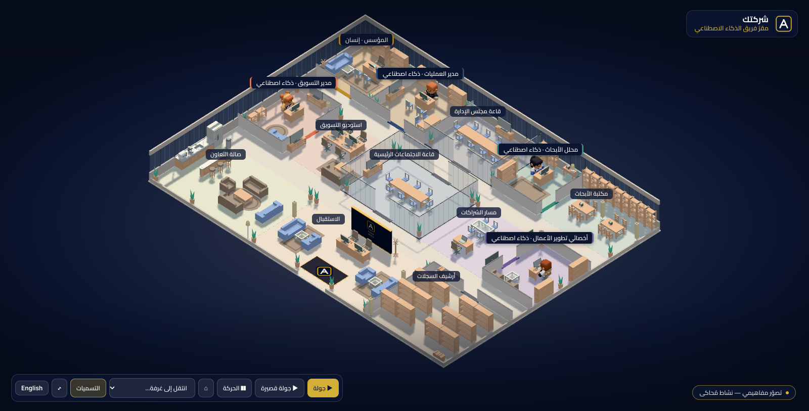

<div dir="rtl" align="right">

<div align="center">

# مجموعة البداية لمكتب الذكاء الاصطناعي ثلاثي الأبعاد

**تصوّر مفاهيمي ثلاثي الأبعاد لمقرّ فريق الذكاء الاصطناعي في شركتك، بالعربية والإنجليزية.**

[English](README.md) · [العربية](README.ar.md)



</div>

أربع شخصيات تمثّل أدوارًا بالذكاء الاصطناعي تعمل على مكاتبها، ثم تتوجّه إلى قاعة الاجتماعات، وتعقد اجتماعًا قصيرًا مُعدًّا مسبقًا، ثم تعود.
وتعرض جولة الكاميرا الموجّهة (58 ثانية، أو نسخة مختصرة مدتها 31 ثانية) المكتب كاملًا مع تعليقات نصية، جاهزةً للتسجيل ونشرها على
لينكدإن وإنستغرام وتيك توك ويوتيوب شورتس.

يمكنك تخصيصه بالكامل من **ملف واحد** هو `office.config.ts`: اسم الشركة، والألوان، والشعار، ومسميات الأدوار، وأسماء الغرف،
والتعليقات النصية، باللغتين. أو دع مساعد برمجة بالذكاء الاصطناعي يقوم بذلك نيابةً عنك باستخدام الأمر الجاهز في [PROMPT.md](PROMPT.md).

## الصدق فيما يعرضه

هذا **تصوّر مفاهيمي**. الشخصيات تتّبع سيناريو ثابتًا مكتوبًا مسبقًا، وليست مرتبطة بأي نظام ذكاء اصطناعي ولا تؤدي أي عمل فعلي.
ويظهر على الشاشة سطر دائم يوضّح ذلك («تصوّر مفاهيمي — نشاط مُحاكى»). نرجو الإبقاء عليه، وعدم وصف الفيديو بأنه بثّ مباشر
أو «موظفونا من الذكاء الاصطناعي أثناء العمل».

## ما تحتاج إليه

- **Node.js الإصدار 20.19 أو أحدث** (https://nodejs.org)
- متصفح **Google Chrome** (أو Chromium) للعرض والتسجيل
- نحو 250 ميغابايت من المساحة بعد التثبيت
- لا حاجة إلى حسابات أو مفاتيح API أو خدمات مدفوعة

## ابدأ بأمرين

<div dir="ltr">

```bash
npm install
npm run dev
```

</div>

افتح **http://127.0.0.1:5173** في Chrome، وأضف `?lang=ar` لعرض الواجهة بالعربية.

## اجعله خاصًا بشركتك

### الطريقة السريعة: اطلب ذلك من مساعد برمجة بالذكاء الاصطناعي

افتح هذا المجلد في Claude Code أو Cursor أو Windsurf أو أداة مشابهة، والصق الأمر الموجود في [PROMPT.md](PROMPT.md).
سيطلب منك بياناتك، ثم يعدّل ملف الإعدادات، ويشغّل الفحوصات، ويعرض لك النتيجة.
وفي Claude Code يمكنك أيضًا كتابة `/customize-ai-office`.

### يدويًا

1. افتح `office.config.ts`. لكل نص ظاهر نسخة إنجليزية `en` ونسخة عربية `ar`.
2. غيّر اسم الشركة، ولوني الهوية، ومسميات الأدوار الأربعة، وأسماء الغرف.
3. ضع ملفات شعارك في `public/brand/` واجعل `brand.logo` و`brand.mark` يشيران إليها:
   - **logo** (الشعار الكامل): نسخة *فاتحة* لأنها تظهر فوق اللون الأساسي الداكن، بصيغة PNG بخلفية شفافة وارتفاع 600 بكسل على الأقل، أو SVG مع تحديد `width` و`height`.
   - **mark** (الرمز): أيقونة مربعة تظهر في شارة الزاوية وعلى سجادة الاستقبال وفي تبويب المتصفح.
4. شغّل الفحوصات:

<div dir="ltr">

```bash
npm run check
```

</div>

   يكتشف هذا الفحص أي ترجمة ناقصة، أو ملف شعار مفقود، أو اسم غرفة مكرّر، أو لون غير صالح.

**ما يمكنك تغييره من ملف الإعدادات:** جميع النصوص، والألوان، والشعار، والشخصية ثلاثية الأبعاد لكل دور.
**ما يبقى ثابتًا:** مخطط الطابق (13 غرفة، 30 × 22 مترًا)، والأدوار الأربعة، ومشهد الاجتماع.
تغيير هذه العناصر يتطلب تعديل `src/model/` وهو موجّه للمطوّرين.

## العرض والتسجيل

| أضف إلى العنوان | النتيجة |
| --- | --- |
| `?lang=ar` / `?lang=en` | اللغة |
| `?autoplay=full` | تبدأ الجولة الكاملة (58 ثانية) تلقائيًا |
| `?autoplay=short` | تبدأ الجولة القصيرة (31 ثانية) تلقائيًا |
| `?clean=1` | إخفاء شريط التحكم والمؤشر (للتسجيل) |
| `?frame=9x16` | إطار عمودي لريلز وتيك توك وشورتس (ويتوفر أيضًا `1x1` و`4x5` و`16x9`) |
| `?dev=1` | وضع المطوّر (لوحات تنقّل، بالإنجليزية فقط) |

اجمع بينها بالرمز `&`، مثلًا:
<span dir="ltr">`http://127.0.0.1:5173/?lang=ar&autoplay=short&clean=1&frame=9x16`</span>

**نصائح للتسجيل**
1. أغلق التطبيقات الثقيلة الأخرى، واستخدم Chrome بملء الشاشة (`Shift+F`).
2. شغّل أداة تسجيل الشاشة (في macOS: ‏`Shift+Cmd+5`، وفي Windows: ‏Xbox Game Bar عبر `Win+G`، أو برنامج OBS المجاني).
3. افتح العنوان مع `autoplay` و`clean=1`. الجولة متطابقة في كل مرة، لذا يمكنك إعادة التسجيل حتى تحصل على النتيجة المطلوبة.
4. قصّ الفيديو على حدود الإطار في برنامج المونتاج، مع إبقاء سطر التوضيح ظاهرًا.

**المفاتيح:** ‏`T` الجولة الكاملة · `Shift+T` الجولة القصيرة · `Space` إيقاف مؤقت · `R` من البداية · `←` `→` اللقطة السابقة / التالية ·
`Esc` الخروج من الجولة · `L` التسميات · `H` المنظر العام · `Q` / `E` تدوير · `+` / `−` تكبير وتصغير · `Shift+F` ملء الشاشة.

## نشره كموقع ويب (اختياري)

<div dir="ltr">

```bash
npm run build
```

</div>

ينتج هذا الأمر موقعًا ثابتًا في المجلد `dist/` يمكن استضافته على أي خدمة للمواقع الثابتة (مثل GitHub Pages أو Netlify أو
Cloudflare Pages، ولكلٍّ منها خطة مجانية). راجع شروط الاستضافة إذا كان الاستخدام تجاريًا.

## الفحوصات

| الأمر | ما يفحصه |
| --- | --- |
| `npm run check` | فحص الأنواع و97 اختبارًا: مخطط الطابق، والمسارات، والجلوس، والحركة، والجولات، وملف إعداداتك |
| `npm run build && npm run check:browser` | يفتح الموقع المبني في Chrome دون واجهة بالإنجليزية والعربية وفي إطار عمودي (37 فحصًا)، ويحفظ لقطات شاشة في `check-output/` |

## البنية التقنية

React 19 وthree.js وReact Three Fiber وTypeScript وVite. كل شيء يعمل داخل المتصفح؛ لا تُرسَل أي بيانات إلى أي جهة، ولا يُحمَّل
أي ملف من الإنترنت. حركة الشخصيات ومساراتها وجولات الكاميرا دوالّ رياضية للزمن، لذا تتطابق كل لقطة في كل مرة.

| المسار | المحتوى |
| --- | --- |
| `office.config.ts` | كل ما تخصّصه |
| `src/i18n.ts` | إدارة اللغة ونصوص الواجهة (بالعربية والإنجليزية) |
| `src/model/` | مخطط الطابق، وتوزيع الأثاث، وإيجاد المسارات، والحركة، وجولات الكاميرا |
| `src/scene/` | المشهد ثلاثي الأبعاد: المبنى، والأثاث، والشخصيات، والكاميرا، والتسميات |
| `src/ui/` | واجهة العرض |
| `public/vendor/` | النماذج ثلاثية الأبعاد (من Kenney، ملكية عامة) |
| `public/brand/` | الشعار والرمز والخطوط |
| `tests/` و`tools/` | الاختبارات وفحص المتصفح |

## الحقوق والتراخيص

- الشيفرة البرمجية: ترخيص MIT، انظر [LICENSE](LICENSE). من إعداد URM ENROLL.
- الأثاث والشخصيات ثلاثية الأبعاد: [Kenney](https://kenney.nl)، ترخيص CC0 (ملكية عامة).
- الخطوط: Inter وCairo، ترخيص SIL Open Font License 1.1 (ملفات الترخيص في `public/brand/fonts/`).
- التفاصيل: [THIRD-PARTY-ASSETS.md](THIRD-PARTY-ASSETS.md).

</div>
