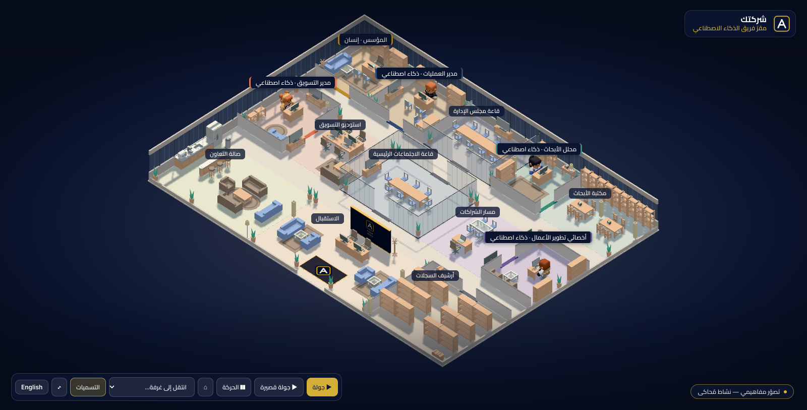

<div align="center">

# AI Office 3D Starter Kit

**A 3D concept visualisation of your company's AI-team headquarters, in English and Arabic.**

[English](README.md) · [العربية](README.ar.md)



</div>

Four AI role figures work at their desks, walk to the meeting room, hold a short staged meeting and return.
A guided camera tour (58 seconds, or a 31-second cut) shows the whole office with captions, ready to record for
LinkedIn, Instagram, TikTok or YouTube Shorts.

You make it yours by editing **one file**, `office.config.ts`: company name, colours, logo, role titles, room names
and captions, in both languages. Or let an AI coding assistant do it for you with the prompt in [PROMPT.md](PROMPT.md).

## Be honest about what it shows

This is a **concept visualisation**. The figures follow a fixed, pre-written script. They are not connected to any AI
system and do no real work. A permanent line on screen says so ("Concept visualisation — simulated activity").
Please keep it, and don't describe the video as live, real-time or "our AI employees working".

## What you need

- **Node.js 20.19+ or 22.12+** (Node 24 LTS recommended; https://nodejs.org)
- **Google Chrome** (or Chromium) to view and record it
- About 150 MB of disk space after installing
- No accounts, API keys or paid services

## Start in two commands

```bash
npm install
npm run dev
```

Open **http://127.0.0.1:5173** in Chrome. Add `?lang=ar` for Arabic.

## Make it yours

### The quick way: ask an AI coding assistant

Open this folder in Claude Code, Cursor, Windsurf or a similar tool and paste the prompt from [PROMPT.md](PROMPT.md).
It asks for your details, edits the config, runs the checks and shows you the result.
In Claude Code you can also type `/customize-ai-office`.

### By hand

1. Open `office.config.ts`. Every visible text has an `en` and an `ar` version.
2. Change the company name, the two brand colours, the four role titles (and their short labels) and the room names.
   Each role slot has its own rooms, so rename them with the role: `coo` → `coo_office`; `marketing` → `marketing_office`,
   `marketing_studio`; `admissions` → `admissions_office`, `admissions_library`; `bizdev` → `bizdev_office`, `bizdev_pipeline`.
3. Put your logo files in `public/brand/` and point `brand.logo` and `brand.mark` at them:
   - **logo**: a *light* version (it sits on your dark primary colour), transparent PNG at least 600 px tall, or an SVG with `width` and `height` set.
   - **mark**: a square icon, used for the corner badge, the welcome mat and the browser tab.
4. Run the checks:

   ```bash
   npm run check
   ```

   This catches a missing translation, a missing logo file, a duplicate room name or a bad colour.

**What you can change from the config:** all text, colours, logo, which character model each role uses.
**What stays fixed:** the floor plan (13 rooms, 30 × 22 m), the four role slots and the meeting choreography.
Changing those means editing `src/model/` and is for developers.

## Watch and record

| Add to the address | Effect |
| --- | --- |
| `?lang=ar` / `?lang=en` | Language |
| `?autoplay=full` | Starts the 58-second tour by itself |
| `?autoplay=short` | Starts the 31-second tour by itself |
| `?clean=1` | Hides the control bar and the cursor (for recording) |
| `?frame=9x16` | Vertical frame for Reels, TikTok and Shorts (also `1x1`, `4x5`, `16x9`) |
| `?dev=1` | Developer mode (navigation panels, English only) |

Combine them with `&`, for example: `http://127.0.0.1:5173/?lang=ar&autoplay=short&clean=1&frame=9x16`

**Recording tips**
1. Close other heavy apps. Use Chrome, full screen (`Shift+F`).
2. Start your screen recorder (macOS: `Shift+Cmd+5`; Windows: Xbox Game Bar `Win+G`; or OBS, free).
3. Load the address with `autoplay` and `clean=1`. The tour is identical every time, so you can record again until it is right.
4. Crop to the frame in your editor. Keep the disclosure line visible.

**Keys:** `T` full tour · `Shift+T` short tour · `Space` pause · `R` restart · `←` `→` previous / next shot ·
`Esc` exit tour · `L` labels · `H` overview · `Q` / `E` rotate · `+` / `−` zoom · `Shift+F` full screen.

## Publish it as a website (optional)

```bash
npm run build
```

This writes a static site to `dist/`. Any static host can serve it (for example GitHub Pages, Netlify or Cloudflare Pages,
all of which have free plans). Check the host's terms for commercial use.

## Checks

| Command | What it checks |
| --- | --- |
| `npm run check` | Type check and 97 unit tests: floor plan, paths, seating, choreography, tours, and your config |
| `npm run build && npm run check:browser` | Opens the built site in a headless Chrome in English, Arabic and a vertical frame (37 checks) and saves screenshots to `check-output/` |

## How it is built

React 19, three.js and React Three Fiber, TypeScript, Vite. Everything runs in the browser; nothing is sent anywhere
and nothing is loaded from the internet. The figures, walking paths and camera tours are pure functions of time, so
every take is the same.

| Path | Contents |
| --- | --- |
| `office.config.ts` | Everything you customise |
| `src/i18n.ts` | Language handling and interface wording (English and Arabic) |
| `src/model/` | Floor plan, furniture layout, pathfinding, choreography, camera tours |
| `src/scene/` | 3D scene: building, furniture, figures, camera, labels |
| `src/ui/` | On-screen interface |
| `public/vendor/` | 3D models (Kenney, public domain) |
| `public/brand/` | Logo, mark and fonts |
| `tests/`, `tools/` | Unit tests and the browser check |

## Credits and licences

- Code: MIT licence, see [LICENSE](LICENSE). Created by URM ENROLL.
- 3D furniture and characters: [Kenney](https://kenney.nl), CC0 (public domain).
- Fonts: Inter and Cairo, SIL Open Font License 1.1 (licence files in `public/brand/fonts/`).
- Details: [THIRD-PARTY-ASSETS.md](THIRD-PARTY-ASSETS.md).
